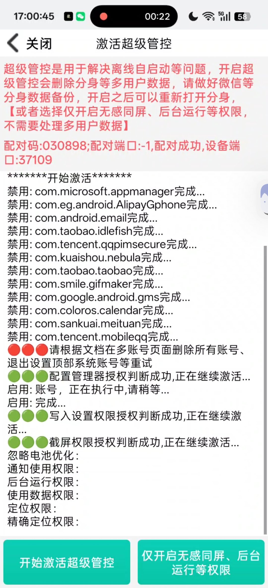
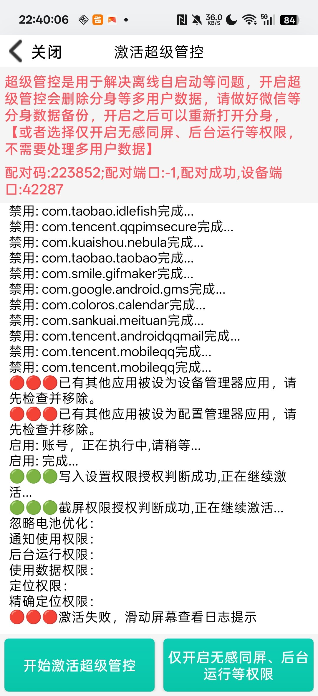

# 实测验证报告（VALIDATION）

> 本文件记录一次**真实对抗结果**：一台已安装商业管控软件的手机，
> 在部署本项目的占位器之后，该软件**激活失败**。
>
> 这不是理论推演。日志、截图、占位状态均可复现。

---

## 一、被测对象

| 项 | 内容 |
|---|---|
| 软件 | **皆成守护 / 超级管控**（应用商店在架，孩子端累计装机 21 万+） |
| 行为 | 通过内置 ADB 客户端连接本机 adbd，批量禁用账号提供者，再把自己设为设备所有者 |
| 版本时间 | 2026-11-06 |

该软件的完整激活链（从逆向与服务端日志确认）：

```
无线调试配对 → 禁用账号提供者（使 getAccounts() 为空）→ dpm set-device-owner
→ addUserRestriction("no_safe_boot") 等 → 恢复账号提供者
```

---

## 二、测试环境

| 项 | 内容 |
|---|---|
| 设备 | OPPO K13 Turbo Pro（PLE110），ColorOS 16.0.10.600，Android 16 / SDK 36 |
| 账号 | 11 个（百度×3、QQ邮箱、抖音×2、迅雷、夸克、美团、百度视频） |
| 占位器 | `com.guard.ownerguard`，以 **Profile Owner** 身份占位 |
| 验证方式 | `adb shell dpm list-owners` |

---

## 三、对照组：**未部署占位器**（2026-11-06 17:01）



日志原文（节选）：

```
配对码:030898;配对端口:-1,配对成功,设备端口:37109
******开始激活******
禁用: com.microsoft.appmanager完成...
禁用: com.eg.android.AlipayGphone完成...
禁用: com.taobao.idlefish完成...
禁用: com.kuaishou.nebula完成...
禁用: com.google.android.gms完成...
禁用: com.sankuai.meituan完成...
禁用: com.tencent.mobileqq完成...
🟢🟢🟢配置管理器授权判断成功,正在继续激活...
启用: 账号, 正在执行中,请稍等...
启用: 完成...
🟢🟢🟢写入设置权限授权判断成功,正在继续激活...
🟢🟢🟢截屏权限授权判断成功,正在继续激活...
```

**结果：激活成功。设备所有者被该软件取得，随后安全模式被封禁。**

---

## 四、实验组：**已部署占位器**（2026-11-06 22:40）



日志原文（全文转录）：

```
超级管控是用于解决离线自启动等问题，开启超级管控会删除分身等多用户数据，
请做好微信等分身数据备份，开启之后可以重新打开分身，
【或者选择仅开启无感同屏、后台运行等权限，不需要处理多用户数据】

配对码:223852;配对端口:-1,配对成功,设备端口:42287
禁用: com.taobao.idlefish完成...
禁用: com.tencent.qqpimsecure完成...
禁用: com.kuaishou.nebula完成...
禁用: com.taobao.taobao完成...
禁用: com.smile.gifmaker完成...
禁用: com.google.android.gms完成...
禁用: com.coloros.calendar完成...
禁用: com.sankuai.meituan完成...
禁用: com.tencent.androidqqmail完成...
禁用: com.tencent.mobileqq完成...
禁用: com.tencent.mobileqq完成...

🔴🔴🔴已有其他应用被设为设备管理器应用，请先检查并移除。
🔴🔴🔴已有其他应用被设为配置管理器应用，请先检查并移除。

启用: 账号, 正在执行中,请稍等...
启用: 完成...
🟢🟢🟢写入设置权限授权判断成功,正在继续激活...
🟢🟢🟢截屏权限授权判断成功,正在继续激活...
忽略电池优化:
通知使用权限:
后台运行权限:
使用数据权限:
定位权限:
精确定位权限:

🔴🔴🔴激活失败，滑动屏幕查看日志提示
```

**结果：激活失败。** 它禁用了 10 个账号提供者、恢复了它们，但**卡在设置所有者这一步**。

---

## 五、前后对比

| 步骤 | 无占位（17:01） | 有占位（22:40） |
|---|---|---|
| ADB 配对 | ✅ 成功 | ✅ 成功 |
| 禁用账号提供者 | ✅ 成功 | ✅ 成功 |
| 恢复账号提供者 | ✅ 成功 | ✅ 成功 |
| **设置为设备所有者** | ✅ **成功** | ❌ **被拒绝** |
| 后续权限授予（写入设置/截屏/定位） | ✅ 完成 | ❌ 中断 |
| **最终结果** | **手机被完全接管** | **激活失败** |

### 关键观察

**它并没有变弱——它只是够不到最高那一层。**

在实验组里，它依然能：

- 建立 ADB 连接并执行 shell 命令
- 禁用/启用账号提供者
- 申请写入设置、截屏等普通权限

它唯一做不到的，是把自己设为设备所有者。**而这一步是整条攻击链的枢纽。**

---

## 六、验证结论

1. **占位器确实阻断了商业管控软件的激活**
   对方的报错信息直接点名："已有其他应用被设为配置管理器应用"。

2. **PO 单槽占位已足够**
   无需同时占 DO；`hasProfileOwner(userId) == true` 时 DO 会被拒绝（AOSP `checkDeviceOwnerProvisioningPreConditionLocked` 返回 2）。

3. **阻断点是结构性的，不是检测性的**
   对方不是"被识别为恶意"而失败，而是**目标能力不存在**。换任何一个同类软件，结果相同。

4. **对方只能转为社会工程**
   它的提示是"请先检查并移除"——即要求用户亲手拆除防线。**这是它唯一剩下的手段。**

5. **代价极低**
   占位器 540 行代码 / 3 MB；对方 21 万装机、385 个类的 SDK，在此设备上归零。

6. **对用户的含义**
   以前是"用户求厂商解绑"，现在是"厂商求用户拆除占位器"。**攻守关系反转。**

---

## 七、复现方法

```bash
# 1. 部署占位器并占住 Profile Owner
adb install owner-guard.apk
adb shell dpm set-profile-owner com.guard.ownerguard/.DeviceOwnerAdminReceiver

# 2. 确认
adb shell dpm list-owners
# 期望输出：
#   1 owner:
#   User  0: admin=com.guard.ownerguard/.DeviceOwnerAdminReceiver,ProfileOwner

# 3. 打开目标管控软件，执行其"超级管控"激活流程
# 4. 观察其结果：应停在"设置所有者"阶段并报错
```

---

## 八、安全提示

**任何要求你"移除设备管理器 / 移除配置管理器 / 卸载那个占位应用"的人或软件，都等同于要你交出最高设备权限。**

包括但不限于：

- 管控软件的引导提示
- 客服或"技术支持"
- 亲友的请求（如非本人设备）
- 任何声称"不移除就无法使用"的功能

**占位器本身移除只需一件事：打开应用 → 输入 PIN 解除。** 不需要任何第三方介入。

---

## 九、局限性（诚实声明）

- 本测试只覆盖"通过 ADB 夺取所有者"这一类攻击；
- 对普通权限滥用（无障碍、悬浮窗、通知读取）、数据窃取、钓鱼等**无防护作用**；
- 若管控软件在占位器部署**之前**已取得所有者，则本方案无效；
- 恢复出厂会清除占位，需重新部署。

---

## 十、附：占位器自身的抗删除测试（2026-11-06 22:50）

在已占位状态下，用 adb 依次尝试六种删除手法，**全部失败**：

| # | 手段 | 结果原文 |
|---|---|---|
| 1 | `pm uninstall com.guard.ownerguard` | `Failure [DELETE_FAILED_DEVICE_POLICY_MANAGER]` |
| 2 | `pm uninstall --user 0 com.guard.ownerguard` | `Failure [DELETE_FAILED_DEVICE_POLICY_MANAGER]` |
| 3 | `pm uninstall -k com.guard.ownerguard` | `Failure [DELETE_FAILED_DEVICE_POLICY_MANAGER]` |
| 4 | `pm disable-user --user 0 com.guard.ownerguard` | `SecurityException: Cannot disable a protected package` |
| 5 | `dpm remove-active-admin .../.DeviceOwnerAdminReceiver` | `SecurityException: Attempt to remove non-test admin` |
| 6 | 用**不同签名**重新打包后 `install -r` 覆盖 | `INSTALL_FAILED_UPDATE_INCOMPATIBLE: Existing package ... signatures do not match` |

签名对比（证明第 6 项确实是伪造包）：

```
正版 SHA-256: cd12ff3f8c052031f77339a19e0a9feaf25cd926e2ae11e670b83b9ebb3e75c0
伪造 SHA-256: 42dc87279ebec9b3e405544e932b04b33dac9b93c0acace3ed2f2d40286e8510
```

测试后复核，占位完好：

```
1 owner:
User  0: admin=com.guard.ownerguard/.DeviceOwnerAdminReceiver,ProfileOwner
```

另：`pm clear`（清空数据）会走 `ActivityManagerService.clearApplicationUserData`
的 `isPackageDataProtected` + `MANAGE_USERS` 检查，shell 无此权限，同样会被拒绝
（该命令触及本机安全策略，未实际执行）。

### 结论

**占位器一旦生效，除以下两种方式外无法移除：**

1. 应用内输入正确的移除 PIN（用户本人）；
2. 恢复出厂（用户本人，且代价是清空整机）。

这既是它的保护力，也是它的风险：**PIN 丢失 = 只能恢复出厂**。
